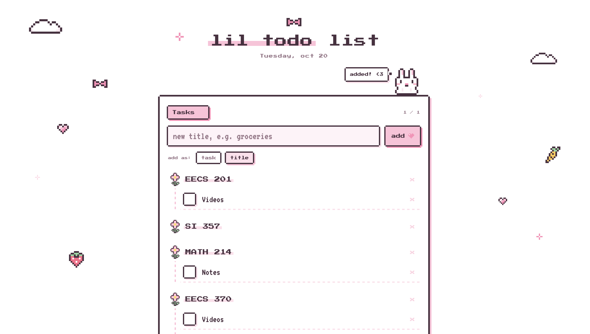
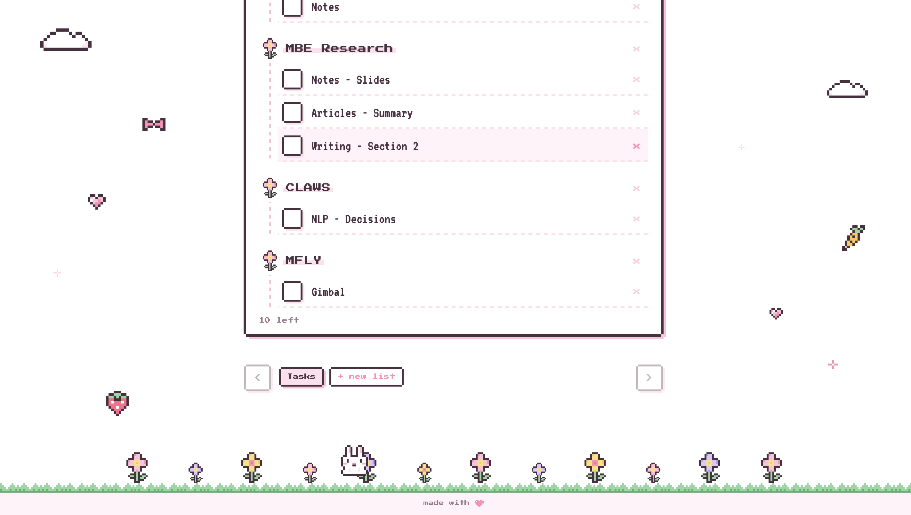

# lil todo list

A pixel-art todo list styled like a pocket journal: a leather-bound book on a dark desk,
a bookshelf along the bottom, and a cool bunny in a red scarf keeping you on track.
Plain static HTML/CSS/JS with no build step. Everything is saved in the browser (localStorage).

- Several lists, each a page (chapter) in the book. Turn pages with the arrows, the index tabs,
  the left/right arrow keys or a swipe. Click a chapter's name to rename it.
- Tasks disappear as soon as you check them off (there's a 5-second undo).
- Add **titles** inside a list ("add as: title") and put subtasks under each one.
- Double-click any task or title to edit it.

## Demo



## Run locally

```sh
npm run dev
python3 -m http.server -d public 8000
```

## Deploy to Cloudflare Pages

Pick one:

1. **Drag & drop.** In the Cloudflare dashboard, go to Workers & Pages → Create → Pages →
   Upload assets, then drop in the `public/` folder.
2. **CLI.** Run `npm run deploy`. The first run asks you to log in to Cloudflare and creates the
   `lil-todo-list` project.
3. **Git.** Push this repo to GitHub/GitLab, then connect it in Workers & Pages →
   Create → Pages → Connect to Git. Use framework preset **None**, leave the build command
   empty, and set the output directory to `public`.

`public/_headers` sets security headers and long-term caching for fonts on Cloudflare.

## Files

- `public/sprites.js`: all the pixel art, hand-drawn as character grids (edit them to make new
  sprites). `npm run favicon` regenerates `favicon.svg` and checks the sprite grids.
- `public/app.js`: the app logic (lists, titles, subtasks, check-off, undo, editing, page turning).
- `public/style.css`: pixel borders, colors and animations. Colors are variables at the top.

## Credits

The pixel art is original and drawn in code. The fonts are [Press Start 2P](https://fonts.google.com/specimen/Press+Start+2P)
and [VT323](https://fonts.google.com/specimen/VT323), both under the SIL Open Font License and
self-hosted in `public/fonts/`.
